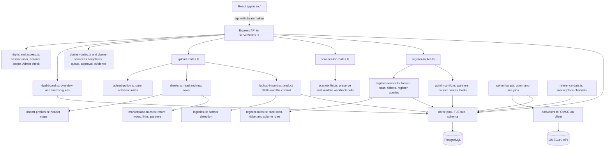

<!-- Updated 2026-10-10. Module names and exports were checked against the source. Not run. -->
# Architecture

## System overview

The app is a single-company web application with two parts. An Express 4 API (`server/`) talks to a PostgreSQL database through `pg`. A React 19 single-page app (`src/`), built with Vite, calls the API. Its inputs are marketplace return report files (CSV or Excel), scanner input (typed or scanned AWBs, the verified items of each return, and webcam video kept on the workstation), and, for the sync jobs only, the OMSGuru HTTP API. Its outputs are JSON responses, CSV and Excel downloads, and rows in the database.

Every request to a data route is limited to the accounts the signed-in user may use. The limit is applied in SQL, so it is not a screen behaviour. The rules are in `server/access.ts` and are described in [API.md](API.md#authorization).

The Server PC Electron app contains the only continuous background worker. It leases and files Meesho claim jobs while an Admin or Supervisor is signed in. OMSGuru sync, order lookups, invoice pull and reports remain command-line scripts run by hand.

## Component diagram



In development, Vite serves the app on port 5173 and forwards `/api` to the API on port `PORT` (3001 by default). In production, `server/index.ts` serves the built `dist/` folder when it exists.

## Request path

1. `requireUser` (in `server/index.ts`) reads the bearer token, loads the session and its user, and computes the user's account scope with `scopeFor` (`server/access.ts`). The request then carries `req.user` with `scope`. A request without a valid session gets 401.
2. Routes that change configuration also pass `requireAdmin` (`server/http.ts`). Any role other than `Admin` gets 403.
3. The route calls a service function with the scope (`scopeOf(req)`). The service builds its SQL with `accountCondition`, which adds the account list as a bound parameter, or `FALSE` when the user has no account.
4. A `ServiceError` becomes its HTTP status (`sendError`). Any other error goes to the error handler, which returns 500 with the message.

A service function with no scope argument defaults to every account. That default exists so that the existing database test and the scripts keep working. Every route passes the signed-in scope.

## Data flows

### Starting up

`server/index.ts` starts the HTTP listener first. It then calls `initDatabase()` in `server/db.ts`. That:

1. runs `SELECT 1` on the pool;
2. runs `applySchema()`, which applies the four schema files in order, in one transaction:
   - `server/schema.sql` (base tables; the snapshot tables are kept but not used),
   - `server/schema-import.sql` (lookup status, register tables, categories, audit),
   - `server/schema-register.sql` (partners, tracking evidence, scan snapshots),
   - `server/schema-scan-history.sql` (scan history snapshots and indexes);
3. runs `ensureReferenceData()` in `server/reference-data.ts`, which adds the six marketplace channels when they are missing.

Every statement is idempotent. A normal start drops nothing. The app tables are rebuilt only when the legacy check or a schema version bump asks for it (`SCHEMA_VERSION` is 1 and is not bumped). No users, scans, SKUs or sample figures are created. Users come from `npm run user:create`. Until the database is ready, routes that need it answer 503.

### Signing in

`POST /api/auth/login` finds the user by email or login alias, checks the password with bcrypt, inserts a session row, and returns the token. Every later request is checked against that row.

### Uploading a return file

1. **Preview** (`POST /api/uploads/preview`, `server/upload-routes.ts`). The file is read with `parseSpreadsheet()` (`server/sheets.ts`), using the header profile for the chosen account from `server/import-profiles.ts`. A file that cannot be read is fatal, and the response says why. A file with rows for another account is refused. `countPreview()` (`server/upload-policy.ts`) counts scannable, pending, rejected, duplicate, cancelled, blanked-identifier and tracking-difference rows. `resolveProductSkus()` (`server/lookup-import.ts`) finds each product SKU: first the VB EXPORT product master, then the OMSGuru master. The preview is staged in memory for 15 minutes, with its owner and its account, and nothing in the database changes.
2. **Activation** (`POST /api/uploads/import`). The route checks the owner, the age of the preview, the account scope, every blocker and every confirmation again. It removes the staged file, then calls `commitLookupUpload()`. That runs in one transaction under an advisory lock for the account. It writes the batch and all raw rows, sends only scannable rows to lookup groups, cancels and replaces the account's cancelled rows, marks the account's previous active lookup rows `superseded`, activates the new rows, and writes the audit row. Any failure rolls back, so the previous active data stays in place.
3. **Scanner-list validation** (`POST /api/uploads/scanner-list/preview`, `server/scanner-list-routes.ts`). `parseScannerList()` reads every non-empty cell in every worksheet, preserving source coordinates and refusing numeric/scientific values as lookup keys. Each worksheet must be mapped to a verified account. Valid text entries are checked against active lookup rows and prior scans; the route never stages, activates or creates scans.

### Scanning a return

1. **Lookup** (`POST /api/scan/lookup`, `lookupShipment()` in `server/register-service.ts`). The AWB is normalized. A named account the user may not use returns 403. The active lookup rows are matched by tracking ID or alternate ID, limited to the user's accounts. Earlier scans of the same AWB are matched too, so an AWB already received is reported as a duplicate even after its lookup data has been replaced. `decideLookup()` (`server/register-rules.ts`) turns the matches into one of `found`, `duplicate`, `choose` or `not_found`. Nothing is picked silently.
2. **Save** (`POST /api/scan/complete`, `recordScan()`). The route first looks for the scan key: a repeated key returns the first result. The shipment must be in the user's accounts and must still be active. An advisory lock on the AWB in its account serializes concurrent saves. The AWB must not already be received in that account. `validateScanSubmission()` checks every item. New ticket IDs are checked. Then the scan, its items, its issues, any new tickets with their first history row, the evidence counts and the audit row are inserted in one transaction. The scan keeps its own copy of the AWBs, the order, the partner, the source file and batch, and the lines, so a later upload cannot change it.

### Reading the register and the figures

- `GET /api/register` builds its WHERE clause with `buildRegisterWhere()`. Every filter value is a bound parameter, and the account scope is always included. The rows come from one `UNION ALL`: one arm for verified items and one for legacy scans. Both arms have the same 43 columns in the same order. The sort is limited to a fixed list (`sortClauseFor`), and a page is at most 200 rows.
- `GET /api/register/export` uses the same WHERE clause and the same rows, up to 50,000. The column set is chosen with `headersFor()` and `registerRecords()` in `server/register-rules.ts`.
- The overview and claims figures are counted from `receipt_scans`, `receipt_scan_items`, `receipt_scan_issues`, `claim_tickets`, `expected_returns` and `marketplaces` in `server/dashboard.ts`, on each request. Days are counted in Indian Standard Time.

### Changing a ticket

`PATCH /api/tickets/:id/status` finds the account of the ticket through its scan, returns 404 when it is outside the user's accounts, checks the change with `ticketStatusError()`, then updates the ticket, adds a history row and writes the audit row in one transaction. Every change is kept.

### Administrator configuration

- **Issue categories:** only their switches change (`active`, `requiresTicket`). Their codes and rules are in code.
- **Missing-item sub-issues:** a sub-issue can be added to a category that takes sub-issues, and deactivated. Each change is audited.
- **Logistics partners, courier names and tracking hosts:** added or switched on and off in `server/admin-config.ts`, and in `setDomainActive()` in `server/register-routes.ts`. Nothing is deleted. Each change is audited.

### Syncing OMSGuru (command-line scripts only)

`npm run sync:oms` calls `GET /order_api/list_channels`. For each active channel it pages through `POST /order_api/list_channel_listings` with `last_id`, and writes each record to `oms_listings` and each listing SKU to `sku_catalog` (`syncChannelListings` in `server/oms/catalog.ts`). It then pages through `GET /order_api/skus` into `oms_skus` (`syncSkuMaster` in `server/oms/skus.ts`). Each step writes a row to `oms_sync_runs`. The endpoints, the joins and the order status IDs are in [notes/omsguru-api.md](notes/omsguru-api.md).

## Key modules

### Server

| Module | Kind | Responsibility | Main exports |
|---|---|---|---|
| `server/index.ts` | Routes | App setup, sign-in, overview, claims, catalog images, Admin pages, startup | (module entry point) |
| `server/http.ts` | Helpers | The signed-in user, the scope, the Admin check, error mapping | `userOf`, `scopeOf`, `actorOf`, `requireAdmin`, `sendError` |
| `server/access.ts` | Pure | The account rule | `scopeFor`, `allowsAccount`, `accountCondition`, `accountListParam`, `isAdminRole`, `ALL_ACCOUNTS`, `NO_ACCOUNTS`, `NO_ACCESS_MESSAGE` |
| `server/dashboard.ts` | Database | Overview, claims and recent-scan figures, scoped | `loadDashboard`, `loadClaims`, `listRecentReturns`, `mapReturn`, `loadHeadline` |
| `server/claims-routes.ts` | Routes | Claim queue, scanned-return search, approval-controlled status changes, secure evidence upload/download, Admin template routes | `mountClaimsRoutes` |
| `server/claims-service.ts` | Database | Scoped claims, configurable evidence validation, duplicate prevention, status and audit history | `createClaim`, `listClaims`, `getClaim`, `updateClaimStatus`, `prepareClaimMediaUpload`, template operations |
| `server/upload-routes.ts` | Routes | Upload history, template, preview and activation | `mountUploadRoutes` |
| `server/scanner-list-routes.ts` | Routes | Validation-only multi-sheet scanner-list preview | `mountScannerListRoutes` |
| `server/scanner-list.ts` | Pure | Scanner-list workbook parsing and source provenance | `parseScannerList` |
| `server/upload-policy.ts` | Pure | Preview counts, blockers, confirmations | `countPreview`, `activationBlockers`, `confirmationsNeeded`, `canActivate` |
| `server/register-routes.ts` | Routes | Accounts, scanning, register, export, tickets, Admin configuration | `mountRegisterRoutes`, `filtersFrom`, `submissionFrom` |
| `server/register-service.ts` | Database | Lookup, scan recording, tickets, register queries and export rows, options, workspace figures | `lookupShipment`, `recordScan`, `updateTicketStatus`, `ticketHistory`, `listRegister`, `exportRegisterRows`, `registerOptions`, `scanSession`, `workspaceUi`, `accessibleAccounts`, `listCategories`, `updateCategory`, `writeAudit`, `ServiceError` |
| `server/register-rules.ts` | Pure | Scan rules, lookup decisions, ticket rules, the register row, the column sets and the CSV | `validateScanSubmission`, `decideLookup`, `ticketStatusError`, `mapRegisterRow`, `REGISTER_APPROVED_HEADERS`, `headersFor`, `registerCsv` |
| `server/admin-config.ts` | Database | Logistics partners, courier names, tracking hosts, with audit | `listPartners`, `addPartner`, `setPartnerActive`, `addAlias`, `setAliasActive`, `addDomain` |
| `server/db.ts` | Infrastructure | Connection pool, the TLS rule, schema application | `getPool`, `openPool`, `connectionSettingsFor`, `applySchema`, `initDatabase` |
| `server/reference-data.ts` | Database | The six marketplace channels | `ensureReferenceData` |
| `server/lookup-import.ts` | Database | Product SKU resolution, including the parent listing, and the lookup commit | `resolveProductSkus`, `masterSkusForListings`, `commitLookupUpload`, `identifierFor`, `ProductSource` |
| `server/sheets.ts` | Parsing | Reads CSV and Excel, the number rules, the row mapping, duplicate flags | `parseSpreadsheet`, `inspectLayout`, `parseProductMaster`, `templateCsv`, `ParsedRow` |
| `server/import-profiles.ts` | Configuration | Header maps and seller IDs per layout, the redacted columns | `importProfiles`, `profileForMarketplace`, `PRODUCT_MASTER_FILE` |
| `server/marketplace-rules.ts` | Pure | Header normalization, return types, SKU variation, listing candidates, tracking links, partner detection from the courier name | `normalizeHeader`, `normalizeReturnType`, `skuWithVariation`, `listingSkuCandidates`, `parentListingSku`, `compactSkuKey`, `resolveTrackingId`, `detectPartner` |
| `server/catalog-image.ts` | HTTP | Fetches and caches a stored catalog image | `sendCatalogImage` |
| `server/logistics.ts` | Database | The partner index used by detection. Detection uses the courier name, not the tracking link | `loadPartnerIndex`, `applyPartners` |
| `server/claim-automation-routes.ts` | Routes | Unified claim creation, desktop bot polling and status updates | `mountClaimAutomationRoutes` |
| `server/claim-automation-service.ts` | Database | Ticket synchronizer linking claims to the register, job queue management | `syncClaimTicketToRegister`, `createOrQueueAutomationJob`, `pollAutomationJob`, `updateAutomationJob` |
| `server/claim-follow-up-service.ts` | Database | Ticket follow-up tracking: the row created when a filing job completes, the agent lease on the next due ticket check, and the record that reschedules or stops it | `createFollowUpForJob`, `leaseNextDueFollowUp`, `recordFollowUpResult`, `normalizeFollowUpStatus`, `decideFollowUpStep` |
| `server/product-master-routes.ts` | Routes | Staged batched product master import routes (`/start`, `/batch`, `/cancel`) | `mountProductMasterRoutes` |
| `server/product-master.ts` | Database | 500-row chunking, in-memory staging with TTL, and isolated batch commits | `stageMasterImport`, `commitMasterBatch`, `cancelMasterImport` |
| `server/oms/master-bridge.ts` | Database | Pure channel mapping and nightly OMSGuru to product master mapping bridge | `marketplaceForChannel`, `bridgeMasterMappings` |
| `server/mobile-release.ts` | Routes & Meta | Mobile APK release manifest and binary download streamer | `getMobileReleaseManifest`, `streamLatestApk` |
| `server/vms-catalog.ts` | Database | Read-only VMS catalog image sync into `product_master` | `syncVmsCatalog` |
| `server/format.ts` | Pure | Display formatting and INR currency formatting | `formatCount`, `formatInr`, `percentOf`, `formatScanTime`, `formatUploadLabel`, `headerDateLabel`, `lastSignInLabel` |
| `server/seed.ts` | Empty | Left from the removed demo seed. Safe to delete | none |
| `server/scripts/` | Command-line jobs | `create-user`, `load-product-master`, `inspect-layout`, `sync-oms-catalog`, `sync-oms-daily`, `sync-vms-catalog`, `fetch-oms-orders`, `report-returns` | none |
| `server/tests/` | Tests | `node:test` files. See [TESTING.md](TESTING.md) | none |


### Schema files

| File | What it adds | Runs |
|---|---|---|
| `server/schema.sql` | Base tables: marketplaces, users, sessions, couriers, SKUs, upload batches, expected returns and items, receipt scans, claim tickets, sub-issue options, evidence. The snapshot tables are kept and not used | First |
| `server/schema-import.sql` | Lookup status, the partial unique index for active AWBs per account, lookup lines, issue categories, scan items and issues, claim history, the audit log, product master, OMSGuru tables | Second |
| `server/schema-register.sql` | Logistics partners and their aliases and hosts (seeded), tracking evidence and validation, return type and display identifiers, scan snapshots | Third |
| `server/schema-scan-history.sql` | Scan snapshots for the file AWB, the link AWB, the tracking source, the forward AWB, the return event, the source file and the raw return type; four indexes | Fourth |
| `server/schema-claims.sql` | Configurable claim templates, immutable scan-linked claims, evidence metadata, 24-month retention dates and status history | Last |

Every file is additive and runs on every start. A change to the schema goes into one of these files, or into a new file that is added to `SCHEMA_FILES` in `server/db.ts`, in the order it must run.

### Client

| Module | Responsibility |
|---|---|
| `src/main.tsx` | React root |
| `src/App.tsx` | Session and page address. `/` Overview, `/scan`, `/register`, `/claims`, `/uploads`, `/admin`. Admin is shown to administrators only |
| `src/routes.ts` | `PAGE_PATH` and `pageFromPath` |
| `src/api.ts` | `api()` (adds the bearer token), `ApiError` (`status`, `details`, `body`), `downloadFile()` |
| `src/access.ts` | `isAdminUser()`, for what the screen shows. The server enforces the same rule |
| `src/workspace.tsx` | `WorkspaceContext` and `useWorkspace()`: the user, the claims badge, the header date, navigation |
| `src/shell.tsx` | Sidebar (Admin for administrators only), header, `Loading`, `PageError` |
| `src/ui.tsx` | Shared components: `Badge`, `Icon`, `Modal`, `DataTable` (and its `Column` type), `StatCard`, `MarketplaceBadge`, `PartnerBadge`, `ReturnLogo` |
| `src/partners.ts` | Local logo paths for logistics partners |
| `src/returns-table.tsx` | Recent-scan rows on the Overview. Its editable ticket cell is not used by any page. See the UI audit |
| `src/csv.ts` | `toCsv()` and `saveCsv()`, used by the claims export |
| `src/marketplaces.ts` | `MARKETPLACE_CLASS` (badge colours) used by `ui.tsx`. Its `MARKETPLACES` list is not used for account lists |
| `src/types.ts` | Shared client types for the lookup, the scan, the register, accounts, uploads and the Admin pages |
| `src/pages/` | `Login`, `Dashboard` (Overview), `ScanReturns`, `Reports` (Return register), `Claims`, `Uploads`, `Admin` |

### Native Android warehouse client (`android/`)

The native Android app is written in Kotlin for fast, ergonomics-focused warehouse scanning:
- **Barcode & Label Scanning**: CameraX integration with automatic continuous autofocus and barcode decoding.
- **Claim Capture (`ClaimCaptureActivity`)**: Multi-step photographic and video evidence capture. Enforces 480p SD unboxing video (minimum 15s, maximum 120s, bounded bitrate) to stay reliably under 25 MB.
- **Upload Progress & Reset**: Visual determinate upload dialog showing file-by-file progress (`Uploading evidence files (x of y)...`). On submit completion, prompts "File Next Return (Start Again)", resetting all photo/video slots and claim state back to zero and focusing the search bar for the next order.
- **Resilient Uploads**: Direct upload to Firebase Storage and server media endpoints with fallback to Android `WorkManager` for background retry on network jitter.
- **In-App Auto-Updates (`AppUpdater.kt`)**: Checks `/api/app/latest` on start and prompts the operator to update when a new version is published.

### Cross-platform Desktop Application & Claim Bot (`desktop/` & `desktop-agent/`)

The system ships as **one automation engine** (`desktop-agent/`) driven by a thin Electron
shell (`desktop/`) on Windows, Linux and macOS, and by a headless Linux service (Docker or
systemd) in server mode. The engine — not the shell — owns the worker loop, so closing a
desktop window can never interrupt a claim. Operator guide: [DESKTOP-APP.md](DESKTOP-APP.md);
server guide: [LINUX-SERVER.md](LINUX-SERVER.md); decisions and alternatives:
[notes/architecture-decision.md](notes/architecture-decision.md).

- **Three deployment modes, one codebase:**
  - **Mode 1 — Windows Desktop.** Electron shell embeds the engine on `127.0.0.1:3005`. Tray, auto-start, `ReturnAppClaimBot` Scheduled Task, visible system browser.
  - **Mode 2 — Linux Desktop.** Identical shell and engine; AppImage/deb packaging, system Chromium/Chrome, auto-start via a `.desktop` entry.
  - **Mode 3 — Headless Linux Server.** The engine alone under Docker or systemd (`deploy/engine/`), headless Chromium over CDP, no window, no desktop environment. Closing the desktop client does not stop automation.
- **Automation engine (`desktop-agent/src/desktop-app-server.ts`):**
  - Owns the single worker loop, the panel queue, the browser runner and the control API. `pollAndProcessJob()` returns whether it handled a claim, and the scheduler backs off 10s → 20s → 30s while the queue is empty.
  - Owns the follow-up ticket worker on its own, much slower cadence (`FOLLOWUP_INTERVAL_MS`, 30 minutes by default). Each cycle asks the server for the next due ticket check, opens that panel's saved session, calls the marketplace's `checkClaimStatus()`, and reports the result. The two workers never overlap: both drive the same supplier profile, so `followUpInFlight` blocks a filing cycle and vice versa (`poll-guard.ts`).
  - Serves the dashboard HTML, the legacy dashboard routes, and two engine routes: `GET /api/health` (liveness, never authenticated) and `GET /api/v1/engine/info` (version, bind, uptime, worker status, panel states, data dir).
  - Exposes `engineStatus()`, `engineStart()`, `enginePause()`, `engineRunOnceNow()`, `engineSetBackendUrl()` for an in-process client.
- **Engine bind and remote-access policy (`desktop-agent/src/engine-config.ts`):**
  - A loopback bind (`127.0.0.1` / `::1` / `localhost`) is local mode with no token; the OS user boundary is the guard.
  - Any other bind is remote mode and `ENGINE_TOKEN` is **mandatory** (minimum 24 characters). Without it the engine refuses to start, so a reachable engine can never be anonymous.
  - Remote requests authenticate with `Authorization: Bearer <ENGINE_TOKEN>`; the token is compared in constant time and is never logged.
- **Portable engine state (`desktop-agent/src/paths.ts`):** `AGENT_DATA_DIR` relocates config, browser profiles, evidence cache, logs and the operator session, so a container volume or a systemd `ReadWritePaths` folder holds everything. Defaults to `~/.taskflow-claim-agent`.
- **Electron shell as a client (`desktop/main.ts`):**
  - Resolves an engine target: `RETURN_ENGINE_URL` set → connect to that remote engine (no local engine, no local worker, bearer token injected on every request to that origin); unset → embed a local engine on `127.0.0.1:3005`.
  - Owns only the window, the tray, the single-instance lock and auto-start. It no longer contains a second copy of the worker loop.
  - `desktop/preload.cjs` (Preload Script): Enforces a secure boundary with `contextIsolation: true` and `nodeIntegration: false`; exposes only typed verbs (`desktop:notify`, `desktop:get-bot-status`, `desktop:toggle-bot`, `desktop:bot-status-changed`).
  - **Persistent Session Storage:** Operates inside `session.fromPartition("persist:return-app-desktop")`. Once the operator logs in via ID and password, session cookies and device tokens persist indefinitely across reboots.
- **Panel-wise continuous filing (`desktop-agent/src/panel-queue.ts`):**
  - Six isolated supplier panels (Meesho, Flipkart, Amazon, Myntra VB, Myntra EJ, Ajio), each with its own browser profile, cookies, and queue.
  - Round-robin worker skips busy/held/cooling-down panels; a panel that needs OTP/CAPTCHA never blocks the others. State is exposed to the dashboard and tray via `GET /api/panels`.
  - Meesho is fully automated (a claim counts only on a new 9–15 digit Meesho ticket); other panels run assisted (prepare + evidence, operator confirms submit) and never auto-complete.
  - Ticket status reading is a separate, per-marketplace capability. `BaseMarketplaceAutomation.checkClaimStatus()` defaults to `{ supported: false }`, so a marketplace without a reader stops its follow-ups instead of pretending to check; implementing it in a marketplace class turns tracking on for that marketplace.
- **Local secrets (`desktop-agent/src/local-secrets.ts`):** Operator token and PC API key are encrypted with the OS credential store (DPAPI on Windows) inside the packaged app, with a safe file fallback outside Electron.
- **Update check (`desktop-agent/src/update-check.ts`):** Compares the running version against the newest `desktop-v*` GitHub release; the dashboard offers the OS-matched installer download. Check-and-notify only — no silent auto-install.
- **Low-Spec Hardware Discipline (4GB RAM & 2-Core CPU):**
  - **Memory Limits:** Caps V8 heap with `--max-old-space-size=256` and restricts renderer instances with `--renderer-process-limit=2`. Disables spellcheck (`spellcheck: false`) saving ~35MB RAM.
  - **Background Throttling & Low CPU Idle:** Native window timer throttling (`backgroundThrottling: true`) drops renderer activity to 1Hz when minimized to tray. Adaptive backoff scheduler polls every 5s during active claim queues, backing off smoothly to 10s -> 20s -> 30s when empty (< 0.5% idle CPU).
  - **Zombie Process Elimination:** `BrowserRunner.close()` stops the whole browser process tree (`taskkill /T /F` on Windows, process-group kill on Linux/macOS).
- **Streaming Evidence Media Pipeline:**
  - Direct HTTP chunk-to-disk streaming (`ReadableStream.getReader()`) in `AgentClient.downloadEvidenceFiles`, eliminating RAM buffering during unboxing video downloads.
  - Automated disk pruning (`pruneOldEvidenceFiles`) cleans temporary media files older than 24 hours on startup.
- **Installation & Deployment:**
  - `electron-builder` targets: Windows NSIS (`Return.App.Setup.<version>.exe`, `perMachine: true`, `C:\Program Files\Return App\`), Linux AppImage + deb, macOS DMG + ZIP.
  - `build/installer.nsh` custom steps: browser-presence warning, `ReturnAppClaimBot` Scheduled Task (sign-in trigger, hidden launch, restart on failure), task removal on uninstall.
  - Packaged installs register auto-start by default. The app starts hidden in the tray and resumes work only after an Admin or Supervisor session is verified.
  - Every Server PC has a UUID and API key. Queue, credential, media and progress routes require both values; jobs use expiring leases and bounded retries.
  - Automated continuous release via GitHub Actions (`.github/workflows/desktop-release.yml`, windows/ubuntu/macos matrix, one `desktop-v*` release, newest two kept).

## Directory structure


```text
desktop/                      Thin Electron shell (Windows, Linux, macOS)
  main.ts                     Window, tray, single-instance lock, auto-start, engine client
  preload.cjs                 Isolated IPC preload bridge (typed verbs)
desktop-agent/                Marketplace claim automation engine (the portable core)
  src/desktop-app-server.ts   Engine entrypoint: single worker loop, control API, dashboard
  src/engine-config.ts        Bind + remote-access policy (fail-closed on a non-loopback bind)
  src/paths.ts                AGENT_DATA_DIR resolution for profiles, evidence cache, logs, session
  src/browser-runner.ts       CDP browser launcher with per-OS process-tree cleanup
  src/agent-client.ts         Authenticated API client, leases, streaming and evidence-integrity checks
  src/panel-queue.ts          Six isolated panels, round-robin rotation, cooldowns
  src/local-secrets.ts        OS-credential-store encryption (DPAPI) with fallback
  src/update-check.ts         desktop-v* release check (notify only)
  src/marketplaces/meesho.ts  Meesho supplier panel claim filing flow (fully automatic)
  src/marketplaces/*.ts       Assisted engines (Flipkart, Amazon, Myntra, Ajio)
deploy/engine/                Headless Linux server deployment (Dockerfile, compose, systemd, env template)
android/                      Native Kotlin Android return scanner
  app/src/main/               CameraX scanning, photo/video evidence, AppUpdater
server/                       Express API, database setup, file parsers, the register, OMSGuru integration
  index.ts                    Startup, sign-in, overview, claims, Admin pages, static files
  http.ts                     Signed-in user, scope, Admin check, error mapping
  access.ts                   The account rule (pure)
  dashboard.ts                Overview, claims and recent-scan queries (scoped)
  upload-routes.ts            Upload history, template, preview, activation
  upload-policy.ts            Preview counts, blockers and confirmations (pure)
  scanner-list.ts             Multi-sheet scanner-list parser (pure)
  scanner-list-routes.ts      Validation-only scanner-list route
  register-routes.ts          Accounts, scan, register, export, tickets, Admin configuration
  register-service.ts         Lookup, scan recording, tickets, register queries and export (database)
  register-rules.ts           Scan, lookup and ticket rules; the register row, column sets and CSV (pure)
  admin-config.ts             Logistics partners, courier names and tracking hosts (database)
  lookup-import.ts            Product SKU resolution and the lookup commit
  logistics.ts                Partner index for detection
  marketplace-rules.ts        Header normalization, return types, tracking links, partner detection (pure)
  import-profiles.ts          Header maps, seller IDs and redacted columns per layout
  sheets.ts                   CSV and Excel reading, number rules, row mapping
  db.ts                       Connection pool, TLS rule, schema application
  reference-data.ts           The six marketplace channels, added at startup
  schema.sql                  Base tables (snapshot tables kept, not used)
  schema-import.sql           Lookup status, register tables, categories, audit
  schema-register.sql         Partners, tracking evidence, scan snapshots
  schema-scan-history.sql     Scan history snapshots and indexes
  schema-claims.sql           Claim lifecycle, financial reconciliation, evidence and history
  schema-claim-automation.sql Claim automation queue, worker authorization, ticket follow-ups, partial indexes
  claim-follow-up-service.ts  Ticket follow-up tracking (due checks, reschedule every 2 days, stop on a final state)
  format.ts, dates.ts, lifecycle.ts   Display formatting, IST dates, lifecycle counts
  seed.ts                     Empty. Left from the removed demo seed; safe to delete
  oms/                        OMSGuru client, catalog, SKU, invoice and order code
  scripts/                    Command-line jobs
  tests/                      node:test files
src/                          React single-page app
  App.tsx, main.tsx           Session and routing; entry point
  api.ts, access.ts, workspace.tsx, types.ts   Client plumbing and shared types
  shell.tsx, ui.tsx, returns-table.tsx, csv.ts, marketplaces.ts, index.css   Shared UI
  pages/                      One file per page
docs/                         Documentation. docs/notes/ holds working notes and the agent handoff
AGENTS.md                     Entry point for agents. Read it first
CLAUDE.md                     Project rules the code depends on
```

## Design notes

- The server listens on `0.0.0.0`, so other machines on the network can reach it. The port comes from `PORT`. The host is fixed in code.
- CORS is enabled with the defaults of the `cors` package, which allow any origin. See [known risks](notes/agent-handoff.md#known-risks-and-gaps).
- Sessions are rows in the `sessions` table, identified by a random 32-byte token. Sessions do not expire. The `SESSION_SECRET` variable in `.env.example` is not read by the code.
- Staged uploads are held in process memory. They are lost when the server restarts, and the file has to be uploaded again.
- Lookup data is activated, not replaced. Superseded rows stay, so a scan always refers to a row that still exists.
- A scan keeps its own snapshot of its AWBs, order and item values, so it stays correct after the lookup data changes.
- The database's TLS certificate is checked on every connection. No setting turns that check off.
- The app ships with no demo data. Databases created before 2026-10-08 still hold the rows of the removed demo seed. Removing them needs the user's approval.
- The snapshot tables (`report_periods`, `daily_return_stats`, and the others listed in `server/schema.sql`) are no longer read or written. They are kept so that existing databases do not lose rows.
- Route handlers now check the signed-in user's role for every Admin route, and every data route applies the account scope.
- The OMSGuru sync, the order lookups, the invoice pull and the reports are run by hand. They are not scheduled.
