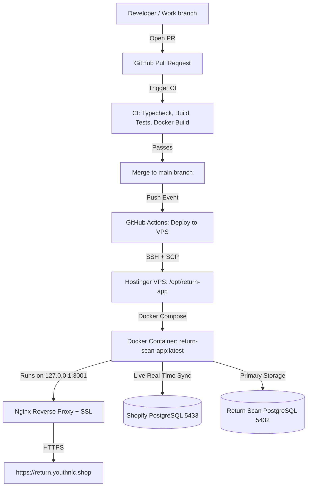

# Deploying Return App on Hostinger VPS with Docker Compose & GitHub Actions

This guide documents the automated CI/CD pipeline and Docker container architecture for deploying the Youthnic Return Scanning App to a Hostinger VPS (`200.141.1.119`).

---

## 1. Architecture Overview



- **Frontend & Backend in One Container**: Multi-stage `Dockerfile` compiles the Vite React SPA to `dist/`, served directly by Express 4 on port `3001`.
- **Zero-Downtime Rebuilds**: Docker Compose builds the new image in the background and restarts the container smoothly.
- **Log Rotation**: Configured in `docker-compose.yml` with `max-size: 10m` and `max-file: 3` so disk space never fills up.

---

## 2. One-Time Hostinger VPS Setup

Log into your Hostinger VPS via SSH as `root`:
```bash
ssh root@200.141.1.119
```

### Step 2.1: Install Docker and Docker Compose
Run the following commands on Ubuntu/Debian:
```bash
# Update package index
apt-get update && apt-get install -y ca-certificates curl gnupg lsb-release

# Add Docker official GPG key
mkdir -p /etc/apt/keyrings
curl -fsSL https://download.docker.com/linux/ubuntu/gpg | gpg --dearmor -o /etc/apt/keyrings/docker.gpg

# Set up Docker repository
echo \
  "deb [arch=$(dpkg --print-architecture) signed-by=/etc/apt/keyrings/docker.gpg] https://download.docker.com/linux/ubuntu \
  $(lsb_release -cs) stable" | tee /etc/apt/sources.list.d/docker.list > /dev/null

# Install Docker Engine and Docker Compose plugin
apt-get update
apt-get install -y docker-ce docker-ce-cli containerd.io docker-buildx-plugin docker-compose-plugin

# Verify installation
docker --version
docker compose version
```

### Step 2.2: Create Application Directory
```bash
mkdir -p /opt/return-app /opt/return-app/data /opt/return-app/certs
chmod 700 /opt/return-app
```

### Step 2.3: Authorize GitHub Actions Deploy Key
Add the public SSH key to `/root/.ssh/authorized_keys` so GitHub Actions can deploy:
```bash
echo "YOUR_GITHUB_DEPLOY_PUBLIC_KEY" >> /root/.ssh/authorized_keys
chmod 600 /root/.ssh/authorized_keys
```

---

## 3. GitHub Repository Secrets & Variables

In GitHub under **Settings → Secrets and variables → Actions**, configure the following:

### Required Secrets:
1. `HOSTINGER_HOST`: `200.141.1.119` (or your VPS IP / domain)
2. `HOSTINGER_USER`: `root`
3. `HOSTINGER_SSH_PORT`: `22`
4. `HOSTINGER_SSH_KEY`: The private SSH key generated for deployment (`~/.ssh/id_ed25519`).
5. `DATABASE_URL`: Primary PostgreSQL connection string with TLS (`postgresql://...`).
6. `SHOPIFY_DATABASE_URL`: External Shopify database connection string (`postgresql://...:5433/...`).
7. `RESEND_API_KEY`: API key for automated shift and daily email reports.

---

## 4. Nginx Reverse Proxy & SSL Configuration

To expose the container to the web with SSL, create `/etc/nginx/sites-available/return-app`:

```nginx
server {
    server_name return.youthnic.shop;

    location / {
        proxy_pass http://127.0.0.1:3001;
        proxy_http_version 1.1;

        proxy_set_header Upgrade $http_upgrade;
        proxy_set_header Connection 'upgrade';
        proxy_set_header Host $host;
        proxy_set_header X-Real-IP $remote_addr;
        proxy_set_header X-Forwarded-For $proxy_add_x_forwarded_for;
        proxy_set_header X-Forwarded-Proto $scheme;

        # Upload limit for Excel/CSV return reports
        client_max_body_size 30M;

        proxy_connect_timeout 60s;
        proxy_send_timeout 60s;
        proxy_read_timeout 60s;
    }
}
```

Enable the configuration and issue SSL:
```bash
ln -sf /etc/nginx/sites-available/return-app /etc/nginx/sites-enabled/
nginx -t && systemctl reload nginx

# Issue free Let's Encrypt SSL certificate
apt-get install -y certbot python3-certbot-nginx
certbot --nginx -d return.youthnic.shop
```

---

## 5. Ongoing Updates via GitHub PR and Actions

Whenever you want to add a feature or fix a bug:
1. Create a feature branch: `git checkout -b feature/my-update`.
2. Commit your changes and push: `git push origin feature/my-update`.
3. Open a **Pull Request (PR)** to `main`.
4. **Automated CI Validation**:
   - TypeScript Typecheck
   - Production Vite Bundle
   - Automated Test Suite (303 tests)
   - Docker Container Build verification
5. Once approved, **Merge PR to `main`**.
6. The `Deploy Return APP to Production VPS` workflow triggers automatically:
   - Transmits package to VPS
   - Executes `docker compose up -d --build`
   - Verifies health check (`http://127.0.0.1:3001/api/health`)
   - Prunes old image layers

---

## 6. Managing the Docker Container on the VPS

Useful commands when logged into the VPS:

```bash
# View running container status & uptime
docker compose -f /opt/return-app/docker-compose.yml ps

# View real-time application logs
docker compose -f /opt/return-app/docker-compose.yml logs -f --tail=100

# Restart the application container
docker compose -f /opt/return-app/docker-compose.yml restart

# Rebuild and start container manually
cd /opt/return-app && docker compose up -d --build
```
